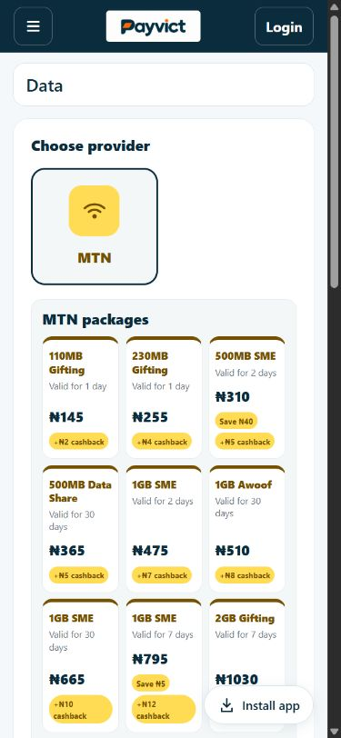

# Payvict

**Digital services, wallet payments and everyday bills in one place.**

### [Visit the live app → payvict-app.onrender.com](https://payvict-app.onrender.com/)

Payvict brings everyday digital purchases into one responsive application. Customers can browse mobile data bundles, pay utility bills, renew cable TV subscriptions and purchase education PINs, with wallet funding and payment history in one place.

Built with Django, the project demonstrates payment integrations, wallet accounting, third-party service APIs and a mobile-friendly checkout experience.

This repository retains its original name, **ResultPin**. Payvict is the current product name; all current development lives here.

## Screenshots

Public screens captured from the hosted app on 19 November 2026. Catalogue prices and availability can change.

### Desktop homepage

### Mobile data catalogue

## Features

- Registration with email verification codes; sign in with an email address or phone number and password.
- Paystack wallet funding and card checkout with server-side payment verification and webhook processing.
- Wallet accounting, transaction history, receipts and cashback on eligible purchases.
- Mobile data catalogue with provider colours, bundle validity and a separate checkout page.
- VTpass integration for electricity, cable TV and education products, subject to enabled services and provider availability.
- Responsive desktop and mobile layouts, expandable provider cards and password visibility controls.
- Installable progressive web app with Android installation prompts and iPhone installation guidance.
- Django administration for catalogues, suppliers, prices and transactions; public blog and FAQ pages.

Explicitly failed purchases use the refund flow. Uncertain provider responses remain pending for reconciliation to avoid treating a potentially delivered service as a failure.

Payvict can be installed as a progressive web app, giving customers convenient access from their home screen on supported devices.

## Technology

| Layer | Tools |
| --- | --- |
| Backend | Python, Django 6, Django REST Framework |
| Frontend | Django templates, Bootstrap 5, CSS and JavaScript |
| Database | PostgreSQL in production; SQLite or a separate PostgreSQL database for development |
| Payments | Paystack |
| Service providers | CheapDataHub and VTpass; optional Nellobyte routing adapter |
| Verification email | Brevo HTTPS API |
| Hosting | Render, Gunicorn and WhiteNoise |

## Run locally

Use Python 3.12 or newer; current development uses Python 3.14. The following commands are for PowerShell:

~~~powershell
git clone https://github.com/niv-3/ResultPin.git
cd ResultPin
python -m venv .venv
.\.venv\Scripts\Activate.ps1
pip install -r requirements.txt
Copy-Item .env.example .env
~~~

Before starting Django, edit `.env`:

1. Set a unique `SECRET_KEY` and keep `DEBUG=True` for local development.
2. Replace the example `DATABASE_URL` with your own local database connection, or use `sqlite:///db.sqlite3` for basic exploration.
3. Use test credentials for payment providers. Keep `VTPASS_TEST_MODE=True`, `VTPASS_BILLS_ENABLED=False` and `DYNAMIC_DATA_ROUTING=False` until you deliberately configure their test flows.
4. Configure email delivery if testing registration verification. Never commit `.env`, API keys or database backups.

Then run:

~~~powershell
python manage.py migrate
python manage.py createsuperuser
python manage.py runserver
~~~

Open [the local app](http://127.0.0.1:8000/) or [Django admin](http://127.0.0.1:8000/admin/). Create local service providers and plans in admin as needed. A new local database has separate users and wallet records from the hosted app.

Do not connect local experiments to the production database or use live provider credentials for routine testing: provider calls can spend real funds.

## Validation

The test suite covers authentication, verification-code expiry, mobile navigation, wallet and payment behaviour, catalogue mappings, pricing and supplier routing. Run it against a separate test database:

~~~powershell
python manage.py test store
~~~

Provider responses are mocked in automated checkout tests. Passing those tests checks application behaviour, not actual delivery by every live supplier.

## Deployment

The live application runs on Render with PostgreSQL. Production uses `core.render_settings`, environment-managed secrets, migrations, collected static files and Gunicorn. Keep production secrets in the host's environment settings.

The repository's existing `render.yaml` contains legacy preview-service settings; review and update it before creating a new deployment from that file.

## Further documentation

- [Data catalogue and pricing assumptions](docs/data-catalogue.md)
- [Multiple-supplier routing, activation and reconciliation](docs/dynamic-data-routing.md)
- [Phone verification setup](docs/phone-otp-setup.md)
- [Voice checkout proposal](docs/voice-checkout.md)
- [Hosted address migration notes](docs/payvict-address-move-readiness.md)

Built by [Victor Nwaigwe](https://github.com/niv-3).
